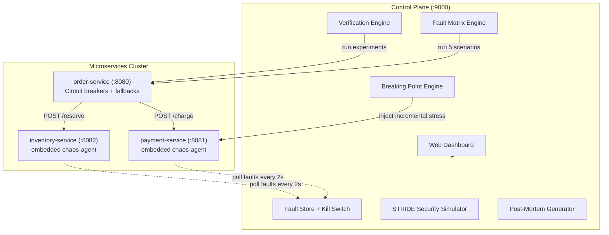

# Chaos Toolkit

[](https://www.oracle.com/java/)
[](https://spring.io/projects/spring-boot)
[](https://resilience4j.readme.io/)
[]()
[]()
[](LICENSE)

**Break your microservices on purpose, and find out how they fail before your users do.**

Most Spring Boot services look healthy right up until a dependency gets slow. I wanted to know: at exactly what point does a service stop coping? So I built a small chaos engineering platform that injects faults into running services, watches how the circuit breakers react, and reports where the breaking point is.

<!-- Add a dashboard screenshot or GIF here: docs/dashboard.png -->

---

## What it does

- **Injects faults** (latency and exceptions) into running services, with a configurable probability so you control the blast radius
- **Finds the breaking point** by ramping up stress step by step until latency crosses your SLO
- **Compares five failure scenarios** side by side, from healthy baseline to total outage
- **Scores resilience** with a simple, transparent formula and a letter grade
- **Simulates security chaos** (credential stuffing, malformed payloads and more) without running any dangerous payloads
- **Writes a post-mortem** in Markdown after an experiment, with no external AI API involved
- **Shows it all live** on a dashboard with an animated service topology

**Built with:** Java 21, Spring Boot 4, Spring AOP, Resilience4j, Chart.js

## How it's built

Three separate pieces:

| Piece | What it is |
|---|---|
| **chaos-agent** | A small library you add to a target service. It uses Spring AOP to intercept methods annotated with `@ChaosLatency` or `@ChaosException`, and polls the control plane every 2 seconds for active faults. Kill switches work both locally and remotely. |
| **chaos-toolkit** | The control plane (port 9000). It holds the active faults in memory, runs the experiments and serves the dashboard. |
| **demo-apps** | Three sample services to practise on: `order-service` (8080, uses Resilience4j circuit breakers and fallbacks), `payment-service` (8081) and `inventory-service` (8082). |



Because the agent only talks to the control plane over REST, your service never depends on the toolkit itself.

### Marking a method for chaos

```java
@Service
public class PaymentGateway {

    @ChaosLatency(defaultMinMs = 100, defaultMaxMs = 500)
    @ChaosException(defaultException = RuntimeException.class, defaultMessage = "Gateway Timeout")
    public PaymentResponse processPayment(PaymentRequest request) {
        // Runs normally when no fault is active
        return new PaymentResponse("TX-" + UUID.randomUUID(), "SUCCESS");
    }
}
```

## The experiments

### Breaking point discovery
The engine sweeps 7 steps, raising injected latency from 200 ms to 2600 ms and the blast radius from 40% to 100%. After each step it checks average and P95 latency against your SLO (2000 ms by default) and reports the exact step where the service tipped from resilient to degraded.

### Five-scenario fault matrix
Five scenarios run back to back, with the circuit breakers reset between each:

| Scenario | What's injected | What I expect | Verdict |
|---|---|---|---|
| Healthy baseline | Nothing | Normal 200 OK, circuit closed | RESILIENT |
| Mild jitter | 300 ms latency, 100% of requests | Slower, but within SLO | RESILIENT |
| Severe latency | 2500 ms latency, 100% of requests | Timeout triggers the fallback | FALLBACK_PROTECTED |
| Flaky service | 50% random exceptions | Retries and fallbacks absorb it | RESILIENT |
| Total outage | 100% failures | Circuit opens, fast fallback | FALLBACK_PROTECTED |

### Resilience score
Each experiment gets a score out of 100:

```
detect_score   = clamp(1 - detection_time / detection_threshold, 0, 1)
recover_score  = clamp(1 - recovery_time / recovery_threshold, 0, 1)
fallback_score = fallback success rate

raw_score = 0.35 * detect_score + 0.35 * recover_score + 0.30 * fallback_score
final     = raw_score * severity_weight(fault type, blast radius)
```

| Grade | Score | Meaning |
|---|---|---|
| A | 90 to 100 | Instant circuit trip, every fallback worked |
| B | 80 to 89 | Strong, with a little recovery lag |
| C | 70 to 79 | Works, but users would notice |
| D | 60 to 69 | SLO violations |
| F | below 60 | Unhandled cascading failures |

### Security chaos (STRIDE)
These simulate the symptoms of an attack safely, to check that your defenses react:

- **Credential stuffing:** 100 rapid bad logins, to test rate limiting and audit logging
- **Privilege escalation:** unauthorised token use across roles
- **Malformed payloads:** corrupted JSON, to test strict deserialization
- **Lateral movement:** probes for leaked metadata and debug endpoints
- **Config drift:** sudden unauthenticated actuator exposure

### Post-mortems
The report generator is fully rule-based. The same experiment gives the same report every time, it runs instantly, and no data leaves your machine. Each report has an executive summary, a timeline (T0, detection, recovery), the score breakdown and prioritised fixes.

## The dashboard

Open http://localhost:9000/ once everything is running.

- **Live topology:** request packets move between services, coloured by outcome (green is normal, amber is delayed, red is a fault, yellow is a fallback)
- **Degradation curve:** latency and error rate against stress, with the SLO line and the breaking point marked
- **Matrix cards:** throughput, error rate, fallback rate, circuit state and verdict for all five scenarios
- **Auto-traffic switch:** generates one request per second so you can watch things react
- **Kill switch:** shuts off every active fault instantly

## Run it

You'll need Java 21+ and Maven 3.9+ (or the included `mvnw`).

```bash
git clone https://github.com/PrajyotKorde-18/Chaos-Toolkit.git
cd Chaos-Toolkit

# Start all four services (Windows)
.\start-all.ps1

# Run the end-to-end checks
.\test-e2e.ps1

# Shut everything down
.\stop-all.ps1
```

Then open http://localhost:9000/. On Command Prompt, use `start-all.bat` and `stop-all.bat` instead.

**A quick first experiment:** turn on Auto-Traffic, activate a latency fault on `payment-service`, and watch the order service's circuit breaker open and switch to its fallback.

## API reference

<details>
<summary>Control plane and fault injection</summary>

| Method | Endpoint | Purpose |
|---|---|---|
| GET | `/api/v1/admin/faults` | List active faults |
| POST | `/api/v1/admin/faults/activate` | Activate a latency or exception fault |
| DELETE | `/api/v1/admin/faults/{service}/{faultId}` | Remove one fault |
| DELETE | `/api/v1/admin/faults/{service}` | Remove all faults for a service |
| POST | `/api/v1/admin/kill-switch/engage` | Engage the global kill switch |
| POST | `/api/v1/admin/kill-switch/release` | Release it |
| GET | `/api/v1/admin/kill-switch/status` | Check its state |

</details>

<details>
<summary>Experiments and reports</summary>

| Method | Endpoint | Purpose |
|---|---|---|
| POST | `/api/v1/verification/run` | Steady-state verification |
| POST | `/api/v1/breaking-point/find` | Breaking point sweep |
| POST | `/api/v1/fault-matrix/run` | Five-scenario matrix |
| POST | `/api/v1/escalation/run` | Progressive multi-stage escalation |
| POST | `/api/v1/security-chaos/run` | STRIDE simulation |
| GET | `/api/v1/reports/post-mortem` | Markdown post-mortem |

</details>

<details>
<summary>Demo app endpoints</summary>

| Method | Endpoint | Purpose |
|---|---|---|
| POST | `localhost:8080/orders/create` | Place an order (calls payment and inventory) |
| GET | `localhost:8080/orders/circuit-breakers` | Live circuit breaker status |
| POST | `localhost:8080/orders/circuit-breakers/reset` | Reset all breakers to CLOSED |

</details>

## Project layout

```
Chaos-Toolkit/
├── chaos-agent/       # Library: annotations, AOP interceptor, fault polling
├── chaos-toolkit/     # Control plane: APIs, experiment engines, dashboard
│   └── demo-apps/     # order, payment and inventory services
├── docs/              # Design notes and milestones
├── start-all / stop-all scripts
└── test-e2e.ps1       # 8-stage verification suite
```

## Storage

Everything runs in memory by default (`ConcurrentHashMap` plus ring-buffered history), so there's no database to set up and it starts in seconds. If you want results to survive restarts, there's an optional Spring Data JPA profile for Supabase or PostgreSQL:

```bash
--spring.profiles.active=supabase
```

## What I learned

- Chaos tools are only useful if they're safe, which is why the kill switch was built before almost anything else
- Circuit breaker settings that look fine on paper behave very differently under real latency
- Randomness needs to be controllable: a probability setting lets you go from "1 in 10 requests fails" to "everything fails" in one click

## Roadmap

- [ ] GitHub Actions CI
- [ ] Unit tests for the scoring calculator
- [ ] Linux and macOS start scripts

## Author

**Prajyot Korde**, IT undergrad at Ramdeobaba University
[LinkedIn](https://www.linkedin.com/in/prajyot-korde-912621281) · [GitHub](https://github.com/PrajyotKorde-18)

MIT licensed.
